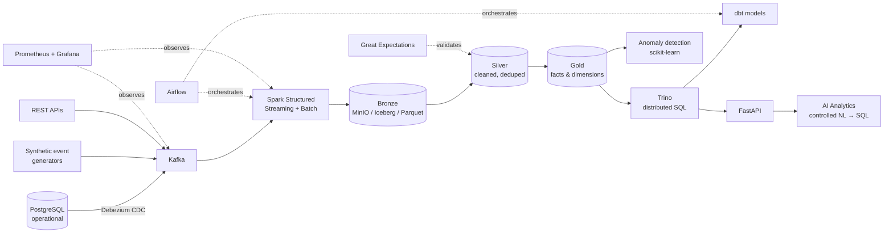

# NEXUS — AI-Native Real-Time Data Lakehouse Platform

> **From raw events to intelligent decisions.**
>
> An end-to-end, production-oriented data engineering platform for real-time ingestion, distributed processing, lakehouse storage, analytics, and AI-powered intelligence.


NEXUS simulates the data infrastructure of a multi-city e-commerce company operating across Morocco — Casablanca, Rabat, Marrakech, Agadir, Tanger, Fès, Meknès, Oujda, Kénitra, Tétouan.

It ingests structured and streaming data, processes events through distributed computing, stores data in an open lakehouse (Medallion: Bronze → Silver → Gold), and exposes reliable analytical datasets, anomaly detection, and a controlled natural-language analytics interface.

**This is an engineering simulation / portfolio project, not a commercial production platform.** All data is synthetic and clearly identified. It runs locally on limited hardware with appropriately scaled datasets. Flink and large-scale deployment are optional extensions, not prerequisites for v1.

## Business questions NEXUS answers

- What is the current sales volume? Which products are most profitable?
- Which cities generate the highest revenue?
- Which products are likely to run out of stock?
- Are there suspicious transaction patterns?
- Why did revenue decrease in a specific period?
- How does current performance compare with historical trends?

## Architecture



Layers: **Sources** (PostgreSQL, REST APIs, synthetic generators) → **Ingestion** (Kafka, Debezium, Python producers) → **Processing** (Spark, optional Flink) → **Storage** (MinIO S3, Iceberg, Parquet) → **Transformation/Query** (dbt, Trino) → **Orchestration/Quality** (Airflow, Great Expectations) → **Serving** (FastAPI, dashboards, ML anomaly detection, LLM NL analytics) → **Infra/Observability** (Docker, Prometheus, Grafana, GitHub Actions).

## Medallion architecture

| Layer | Contents | Rules |
|---|---|---|
| **Bronze** | Raw ingested records, source metadata, ingestion timestamps | Original records preserved, reprocessable |
| **Silver** | Validated, standardised, deduplicated data | Type normalisation, missing-value handling, schema validation, late-event handling |
| **Gold** | Business-ready models: `fact_sales`, `dim_customer`, `dim_product`, inventory analytics, revenue & city aggregations | Built with dbt + SQL, queried via Trino |

## Tech stack

| Category | Technologies |
|---|---|
| Programming | Python, SQL |
| Operational DB | PostgreSQL |
| Streaming / CDC | Apache Kafka, Debezium |
| Processing | Apache Spark (batch + Structured Streaming), Apache Flink *(optional)* |
| Storage | MinIO (S3), Apache Iceberg, Apache Parquet |
| Query / Transform | Trino, dbt |
| Orchestration / Quality | Apache Airflow, Great Expectations |
| API / ML / AI | FastAPI, scikit-learn, LLM APIs (controlled, read-only SQL) |
| Infra / Monitoring / CI | Docker Compose, Prometheus, Grafana, GitHub Actions |

Full deep-dive for every technology — what it is, why it is here, how it connects, what to learn in what order, and the exact concepts used in this repo — is in [`docs/LEARNING.md`](docs/LEARNING.md).

## Quick start (Phase 2 — works today)

```bash
git clone https://github.com/taha-b0t/nexus.git
cd nexus
cp .env.example .env
make setup          # python venv + dependencies
make generate       # synthetic Moroccan e-commerce data -> data/synthetic/
make test           # pytest
make infra-up       # docker compose: PostgreSQL + MinIO (profile: full adds Kafka etc.)
make infra-up-full  # + Kafka (KRaft) + Debezium Connect + topic creation
make stream         # replay data/synthetic/orders.csv into nexus.orders
make api            # FastAPI on http://localhost:8000/docs
```

Without Docker, `make generate && make test` still validates the whole Phase 1 pipeline in pure Python.

## Repository layout

```
nexus/
├── docs/                  # architecture, data model, learning, benchmarks
├── src/
│   ├── data_generation/   # synthetic e-commerce generators (Phase 1, working)
│   ├── ingestion/         # Kafka producers, Debezium CDC config (Phase 2)
│   ├── processing/        # Spark batch + streaming jobs (Phase 3)
│   ├── lakehouse/         # Iceberg / Medallion helpers (Phase 4)
│   ├── analytics/         # anomaly detection (Phase 7)
│   └── api/               # FastAPI + controlled NL analytics (Phase 7)
├── dbt/                   # dbt project: staging / intermediate / marts (Phase 5)
├── airflow/dags/          # orchestration DAGs (Phase 6)
├── infra/                 # kafka, debezium, prometheus, grafana configs
├── tests/                 # unit + data-quality tests
├── docker-compose.yml
└── Makefile
```

## Development phases

| Phase | Scope | Status |
|---|---|---|
| 1 — Foundation | PostgreSQL, Python, data generation, Docker | ✅ In this release |
| 2 — Streaming | Kafka, event schemas, Debezium CDC | ✅ In this release |
| 3 — Processing | Spark batch + Structured Streaming | 🔜 Scaffolded |
| 4 — Lakehouse | MinIO, Parquet, Iceberg, Medallion | 🔜 Scaffolded |
| 5 — Analytics engineering | Trino, dbt, dimensional modelling | 🔜 Scaffolded |
| 6 — Orchestration & quality | Airflow, Great Expectations, tests | 🔜 Scaffolded |
| 7 — Intelligence | Anomaly detection, AI analytics, FastAPI | 🟡 API + detector scaffolded |
| 8 — Production readiness | Monitoring, CI/CD, fault tolerance, docs, benchmarks | 🟡 CI + monitoring scaffolded |

Roadmap detail: [`docs/ROADMAP.md`](docs/ROADMAP.md) · Benchmarks are measured, never assumed: [`docs/BENCHMARKS.md`](docs/BENCHMARKS.md)

## Core engineering principles

Scalability · Reliability (checkpointing, retries, idempotency, dead-letter queues) · Reproducibility · Modularity · Data quality as a first-class concern · Observability (latency, freshness, throughput, failure rate) · Security (least privilege, read-only AI SQL, validation, timeouts, result limits) · Performance optimisation from measured evidence (partitioning, predicate pushdown, compaction).

## AI analytics — security model

Natural-language question → identify approved Gold tables → generate SQL → **validate** (read-only, allow-listed tables, no DDL/DML, timeout + row limit) → execute with a read-only role → return results + explanation. Unrestricted execution is never allowed. See `src/api/nl_analytics.py`.

## Author

**Taha Ben Taleb** — Data Engineering student (DUT Ingénierie des Données, EST Kelaa des Sraghna, Université Cadi Ayyad), building toward Data Engineer.

## License

MIT — see `LICENSE`.
